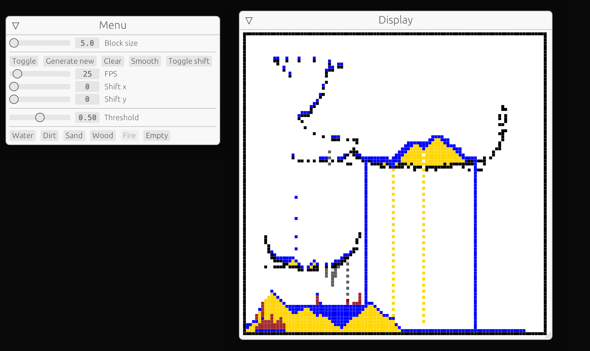

# Rust cellular automata

- Cave generation
- Simulation of various materials
  - Water
  - Sand
  - Wood
  - Fire

## Run natively

Install Rust with rustup and the platform's graphics/linker dependencies. The
repository pins Rust 1.95.0 (including Clippy/rustfmt) and commits Cargo.lock;
Cargo uses this toolchain automatically. On macOS install Xcode Command Line Tools.
On Ubuntu 24.04 install:

```sh
sudo apt-get install pkg-config libxcb-render0-dev libxcb-shape0-dev libxcb-xfixes0-dev libxkbcommon-dev libssl-dev libgl1-mesa-dev
```

Run the desktop application:

```sh
cargo run --locked --release --bin vaja_2
```

Run all native checks and debug/release regressions sequentially:

```sh
bash check.sh
```

Verification runs locally with `bash check.sh`; there are no GitHub Actions
workflows. Graphical interaction was checked on macOS. Windows execution has not
been validated. Dependency updates should deliberately refresh Cargo.lock and
rerun local checks.

The project targets desktop use. The historical assessment is preserved in
[review-report.html](review-report.html); current findings and verification are
tracked in [plans/STATUS.md](plans/STATUS.md).

## Simulation timing

The Steps/s slider requests 1–360 simulation steps per second. Fractional elapsed
time carries across frames. Pause/resume and rate changes start a fresh interval.
After a long stall, an update runs at most 16 catch-up steps and drops excess
whole-step debt to keep the UI responsive; achievable speed still depends on the
machine keeping up. The simulation keeps running when Display is collapsed;
use Toggle to pause or resume it.

## Possible improvements

- use Bevy game engine for rendering
- use shaders
- use GPU rendering

### Info

- This was a small school project for an exercise in a class
- Was built in **less than a week**
- Still new to rust

### New things I learned

- Difference between immediate mode and retained mode UI
- Egui
- A little bit about rust folder structure


